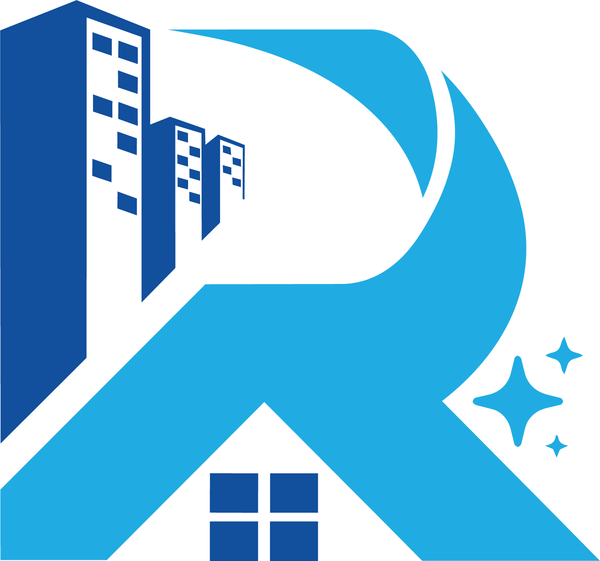
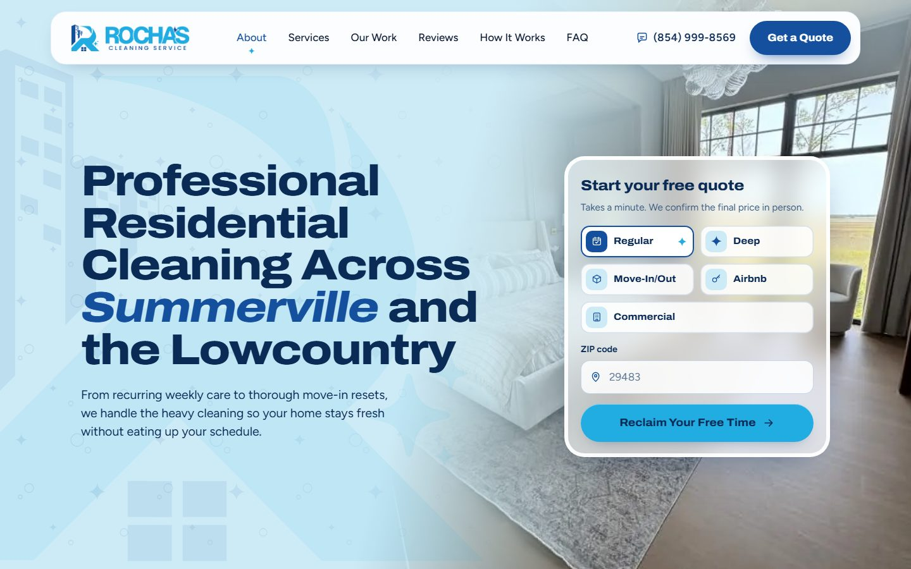
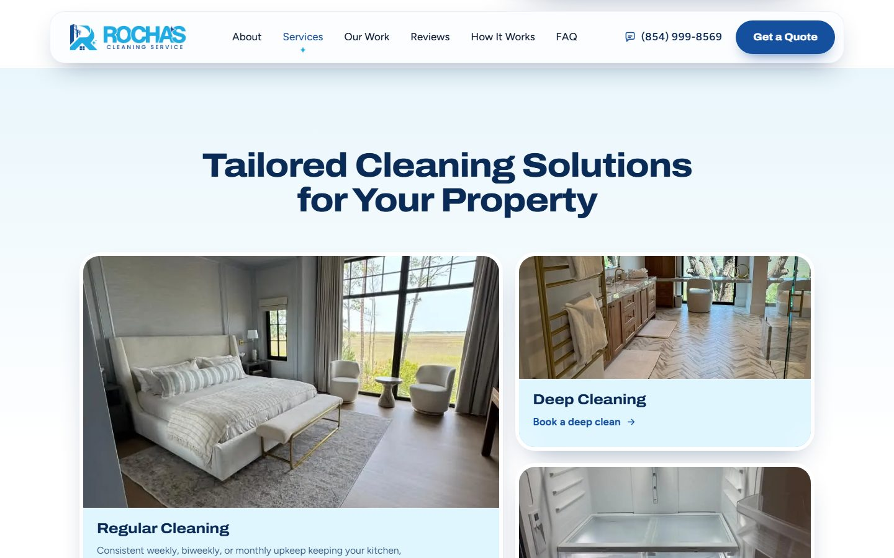
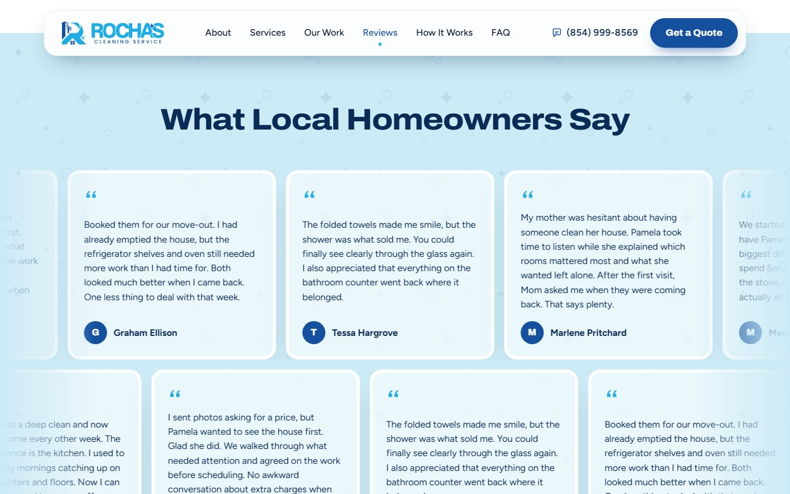
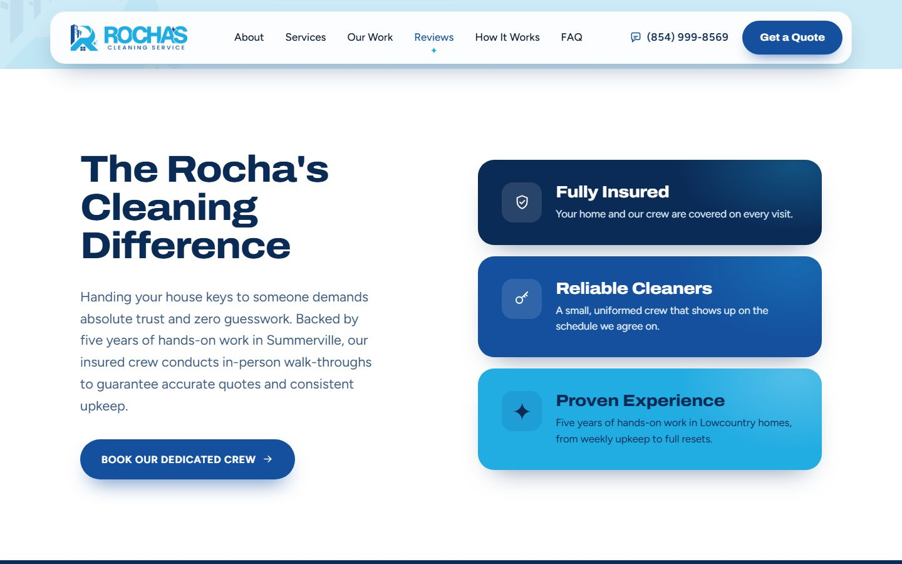
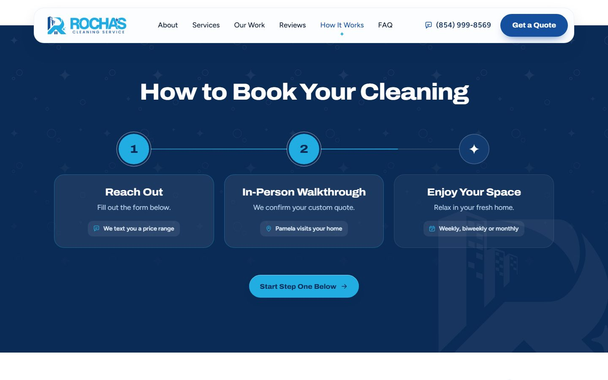
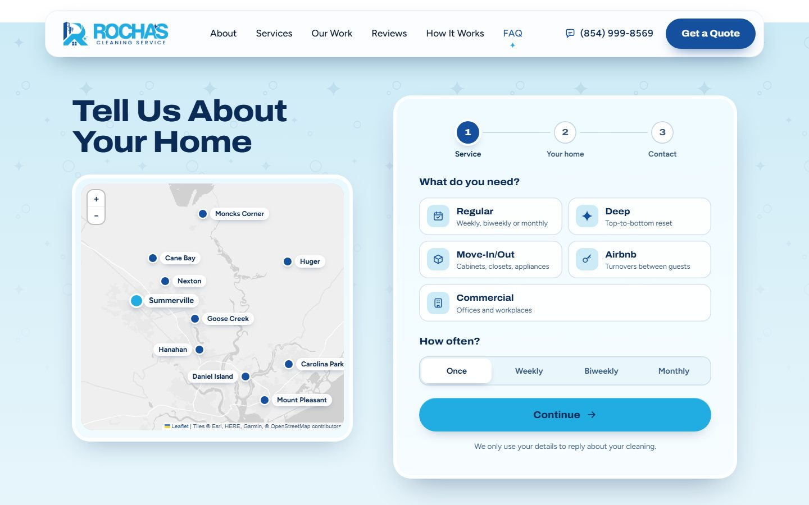
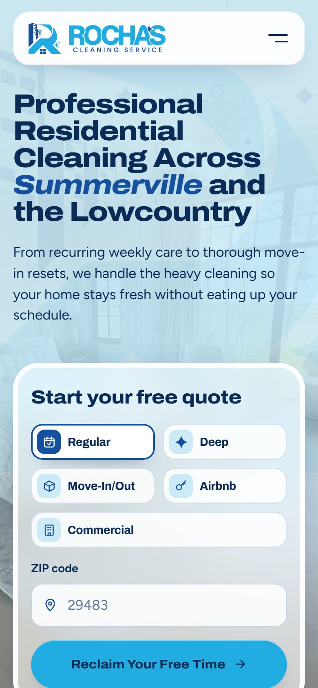
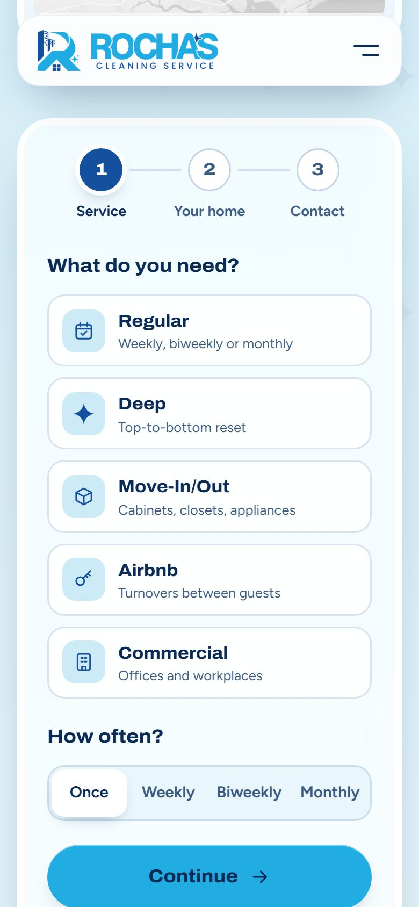
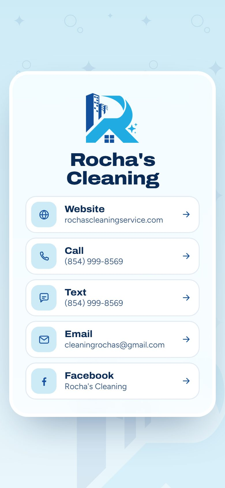

<div align="center">



# Rocha's Cleaning

**One-page website for an owner-operated house cleaning company in Summerville, South Carolina.**

Built to turn ad clicks into quote requests, on a phone, in under a minute.

[rochascleaningservice.com](https://rochascleaningservice.com) &nbsp;·&nbsp; Design and development by [Eu Sou TS](https://eusouts.com.br/)


<br>



</div>

<br>

## The brief

Rocha's Cleaning is a three-person crew led by owner Pamela Rocha, with about five years in Lowcountry homes. The business grew on referrals and needed a site that could:

- win **new recurring clients** (weekly and biweekly) from Google and Meta ads
- build **trust** with homeowners about letting a crew into their home
- make asking for a price **effortless on a phone**, because most visits come from ads

Every quote is confirmed with an in-person walkthrough, so the site never shows prices. It sells trust, then makes the first step tiny.

## Highlights

<table>
<tr>
<td width="50%" valign="top">

**Quote in two taps**<br>
A mini form in the hero (service + ZIP) hands off to a three-step form at the end of the page, already filled in. Every service card and frequency button deep-links into it.

</td>
<td width="50%" valign="top">

**Polish-to-reveal service cards**<br>
Each service photo starts under a soft haze that clears in circular strokes as it scrolls into view, ending on the logo's sparkle. On desktop, the pointer can polish it first.

</td>
</tr>
<tr>
<td valign="top">

**Real service-area map**<br>
Leaflet map with 10, 20 and 30 mile rings around Summerville. Tapping a community pin fills the form's community field.

</td>
<td valign="top">

**Endless, draggable portfolio**<br>
Real job photos drift in an infinite loop with mouse and touch drag, inertia, arrow controls and soft faded edges.

</td>
</tr>
<tr>
<td valign="top">

**Scroll-driven booking timeline**<br>
The "How it works" line fills as you scroll and lights each step when it reaches it. On phones it becomes a vertical timeline.

</td>
<td valign="top">

**Two-row review marquee**<br>
Client reviews drift in opposite directions and pause on hover. Screen readers hear each review once; reduced-motion users get a static list.

</td>
</tr>
</table>

## Screenshots

<table>
<tr>
<td></td>
<td></td>
</tr>
<tr>
<td></td>
<td></td>
</tr>
<tr>
<td colspan="2"></td>
</tr>
</table>

<p align="center">

&nbsp;

&nbsp;

</p>

## Design system

The visual world comes from the logo (an "R" that merges an apartment building with a house roof and sparkles) and from the Lowcountry porch: haint blue ceilings, white trim, navy shutters.

| Token | Color | Used for |
| --- | --- | --- |
| Haint |  | Section grounds, the veil over the hero photo |
| Cyan |  | Actions and anything "done" or "clean" |
| Navy |  | Selected states, icons, secondary buttons |
| Navy deep |  | Headlines, dark bands, footer |

- **Type:** Archivo set wide and heavy for headings (echoing the wordmark), Figtree for text.
- **Material:** frosted glass panels, 6px white trim borders, a subtle sparkle and soap-bubble texture, and the logo icon as a watermark.
- **Rule of thumb:** cyan means clean. It only appears where something is actionable or finished.

## Under the hood

**Performance**
- Static HTML, CSS and vanilla JS, no framework and no build step
- WebP photos with explicit dimensions, lazy loading below the fold, hero image preloaded
- Map stylesheet loaded on demand, so it never blocks the first paint
- Long-lived caching with versioned CSS/JS (`?v=`) for instant cache busting on deploy

**SEO**
- `HouseCleaningService`, `WebSite`, `WebPage` and `FAQPage` structured data
- Local NAP consistency, canonical URLs, Open Graph card, image sitemap
- `robots.txt`, `llms.txt`, `humans.txt` and `.well-known/security.txt`

**Accessibility**
- One H1, semantic landmarks, skip link, visible focus states
- Every interactive control works by keyboard, including map pins and the carousel
- `prefers-reduced-motion` respected by every animation
- Touch targets of at least 44px on phones

**Forms and leads**
- Three-step quote form with per-step validation and US phone and ZIP input masks
- Ad attribution captured with each lead (UTM tags, `gclid`, `fbclid`, landing page)
- Sends to [Web3Forms](https://web3forms.com) and an optional webhook in parallel, so one outage never loses a lead
- Spam protection: honeypot, minimum fill time, link limits and resend throttling

**Security (Apache)**
- HTTPS and HSTS, strict Content Security Policy, clean URLs
- Blocks bad bots, referrer spam and common exploit probes
- Test environment automatically kept out of search results with `X-Robots-Tag`

## Pages

| Path | Purpose |
| --- | --- |
| `/` | One-page site |
| `/privacy-policy` | Privacy policy, including SMS consent terms |
| `/terms-of-use` | Website terms |
| `/redirect` | Contact card for the business card QR code, with a downloadable vCard |
| `/404` | Custom not-found page |

## Run it locally

No install needed. Serve the folder with any static server:

```bash
npx serve .
# or
python -m http.server 8080
```

Clean URLs such as `/privacy-policy` rely on the `.htaccess` rules, so on a plain static server open `privacy-policy.html` directly.

To receive leads, set your Web3Forms access key on the `access_key` field in `index.html`, and optionally a webhook URL in the form's `data-webhook` attribute.

## Project structure

```
├── index.html              One-page site
├── privacy-policy.html
├── terms-of-use.html
├── redirect.html           Contact card (QR destination)
├── 404.html
├── assets/
│   ├── css/style.css       Design system and all components
│   ├── js/main.js          Home page interactions, map, form and carousels
│   ├── js/page.js          Inner pages: menu and header state
│   ├── img/                Logo, photos and share image
│   ├── icons/              Favicons and app icons
│   └── rochas-cleaning.vcf Contact file for the card page
├── .htaccess               Security, caching, compression, clean URLs
├── sitemap.xml · robots.txt · site.webmanifest
└── llms.txt · humans.txt · .well-known/security.txt
```

## Credits

- **Client:** Rocha's Cleaning, Summerville, SC
- **Design and development:** [Eu Sou TS](https://eusouts.com.br/)
- **Photography:** job photos supplied by the client (the commercial office image is illustrative)
- **Map:** [Leaflet](https://leafletjs.com/), tiles by Esri, data by OpenStreetMap contributors
- **Fonts:** [Archivo](https://fonts.google.com/specimen/Archivo) and [Figtree](https://fonts.google.com/specimen/Figtree)

<br>

<sub>The Rocha's Cleaning name, logo, photos and copy belong to Rocha's Cleaning and are shown here as a portfolio piece. Please do not reuse them.</sub>
